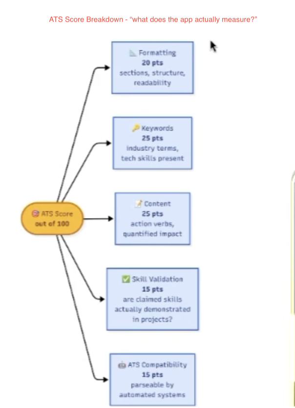
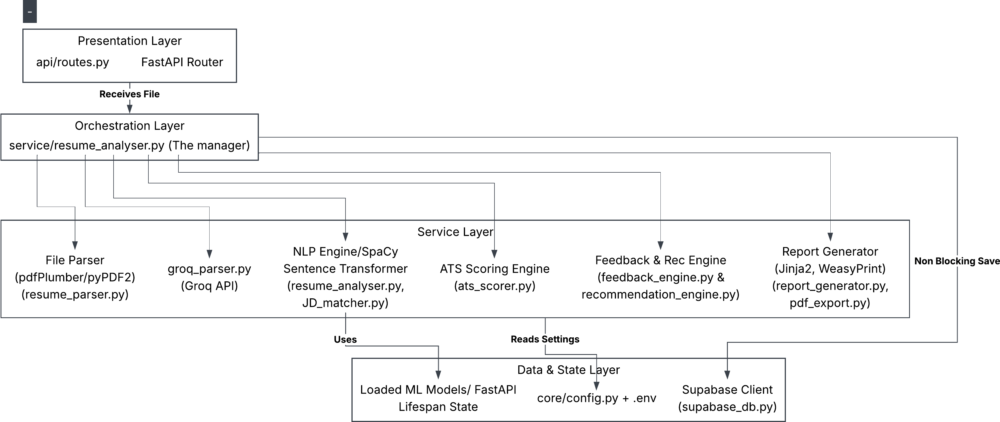
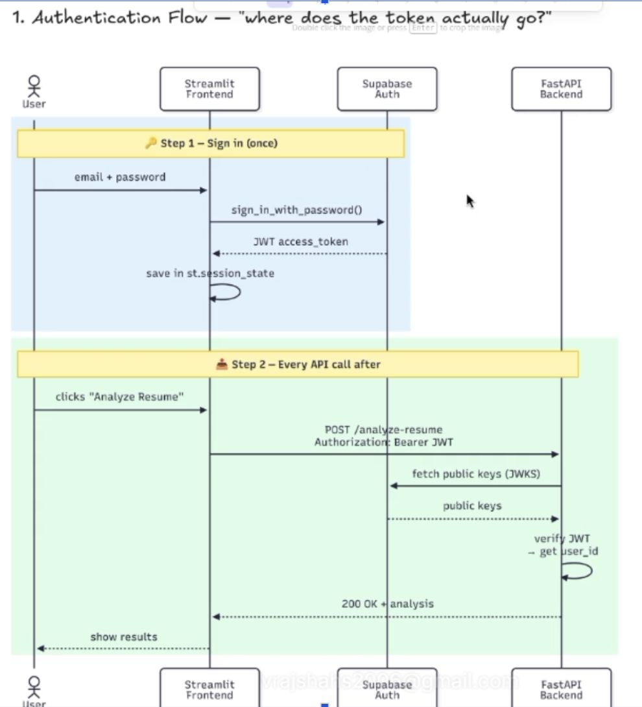

# ATS Resume Scorer — Project Overview

An end-to-end, AI-powered resume analyser. Upload a resume (PDF or DOCX), optionally paste a job description, and get an ATS score out of 100, a breakdown of what drove it, prioritised feedback on what to fix, and a downloadable PDF report.

**Live app:** https://atsscorer-vraj.streamlit.app

---

## 1. The Problem

Most companies filter resumes with Applicant Tracking Systems (ATS) before a human reads them. Candidates rarely find out why they were filtered out. Existing checkers tend to count keywords and stop there, so a candidate can list "Python" and "Docker" under skills and score well without ever showing where they used them.

## 2. The Solution

ATS Scorer evaluates a resume the way an ATS and a recruiter would, combining rule-based checks, NLP, and a fine-tuned language model:

- **Scores** the resume across five components (formatting, keywords, content, skill validation, ATS compatibility).
- **Validates skills**: checks that each listed skill is backed by evidence in a project or job entry, rather than just appearing in a skills list.
- **Compares against a job description** (optional) using both keyword overlap and semantic similarity.
- **Explains the result** with issue-by-issue feedback (severity, why it matters, how to fix it, example improvement).
- **Remembers users**: signed-in users get a saved history and can re-download past reports.

---

## 3. How It Works



| Component | Points | What it measures |
|---|---|---|
| Formatting | 20 | Sections present, structure, bullet points, readability |
| Keywords | 25 | Industry terms and technical skills, plus fuzzy matching against the job description |
| Content | 25 | Action verbs and quantified impact (percentages, numbers, outcomes) |
| Skill Validation | 15 | Are claimed skills actually demonstrated in projects or experience? |
| ATS Compatibility | 15 | Parseability by automated systems, unusual characters, thin sections, location/privacy exposure |

The overall score is simply the **sum of the five component scores** (their maximums add up to exactly 100), so the numbers on screen always add up. When a job description is supplied, a keyword-gap penalty of up to 15 points is subtracted if many of its keywords are missing from the resume. Grammar checking is not implemented yet, so it is left out of the Content score and the remaining Content criteria are scaled to the full 25 points, rather than giving every resume free points.

### Request flow

1. **Upload and validate:** file size (max 5 MB) and true file type are checked from the file contents, not just the extension.
2. **Text extraction:** `pdfplumber` first, `PyPDF2` as an automatic fallback; `python-docx` for Word files, including text inside tables. Hyperlinks (LinkedIn, GitHub) are recovered too.
3. **Structured parsing:** the raw text is sent to an LLM on Groq (`gpt-oss-120b`) with a strict JSON schema, returning skills, experience, projects, education, action verbs and keywords. Responses are validated, with one automatic retry if the JSON is malformed.
4. **Analysis:** skill validation, optional job-description matching, privacy/location detection, and scoring (details below).
5. **Feedback:** issues are generated with severity levels so users know what to fix first.
6. **Response and history:** the result is returned to the UI and saved to the user's history in a non-blocking step, so a database hiccup never breaks the analysis.
7. **PDF report on demand:** Jinja2 templates are rendered and merged into one PDF with WeasyPrint.

---

## 4. Architecture



The backend is organised in layers so each piece can be changed independently:

- **Presentation:** FastAPI router (`api/routes.py`) receives the upload.
- **Orchestration:** `resume_analyser.py` acts as the manager, calling each service in order and assembling one result.
- **Services:** file parser, Groq parser, NLP engine (spaCy + sentence transformer), scoring engine, feedback engine, report generator.
- **Data and state:** ML models are loaded once at startup via FastAPI's lifespan hook (not per request), configuration lives in `core/config.py` and `.env`, and Supabase handles persistence.

Scoring maximums, tiers and thresholds live together in one module (`ats_scorer.py`), so the scoring policy can be tuned in one place.

### Project structure

```
ATS_SCORER/
├── backend/
│   ├── api/            # routes + JWT authentication
│   ├── core/           # config + fine-tuned model
│   ├── database/       # Supabase persistence
│   ├── models/         # Pydantic schemas
│   ├── services/       # parsing, scoring, matching, feedback, reports
│   ├── templates/      # HTML templates for PDF reports
│   └── utils/          # fuzzy matching, file helpers, logging
├── frontend/
│   ├── components/     # dashboard, score display, feedback, JD comparison
│   ├── services/       # API client + Supabase auth client
│   ├── views/          # landing, scorer, history, resources
│   └── streamlit_app.py
├── JupyterNotebook/    # EDA, embeddings, BERT fine-tuning (run on Colab)
└── docs/
```

---

## 5. The AI / ML Layer

### Fine-tuned semantic matching model

Keyword matching cannot tell that "built REST APIs" and "backend engineer" are related. To capture meaning, the app uses a **sentence-transformer embedding model** (`all-mpnet-base-v2`, a BERT-family transformer that reads text bidirectionally) and compares resume and job description by cosine similarity.

Off the shelf embeddings are not tuned to resume–JD relevance, so I **fine-tuned the model on Google Colab (T4 GPU)**, since training on CPU would be far slower.

| | Base model | Fine-tuned |
|---|---|---|
| Mean absolute error vs. labelled match score | 0.1946 | **0.0940** |

- Roughly **52% lower error** on a held out test set (RMSE 0.1178).
- Trained on 280 labelled resume–JD pairs (196 train / 42 validation / 42 test), 10 epochs, batch size 16.
- The dataset is small, so results are encouraging rather than definitive. Growing it is the main next step.

### How each tool is used

| Tool | Role |
|---|---|
| **Sentence-transformer (fine-tuned)** | Semantic similarity between resume and JD; semantic skill-to-project evidence matching |
| **spaCy** (`en_core_web_md`) | Named-entity recognition to count place names (privacy check) and noun phrases for skills-gap analysis; falls back to the small model if the medium one is missing |
| **Groq LLM (`gpt-oss-120b`)** | Turns messy resume and JD text into structured JSON |
| **RapidFuzz** | Fuzzy keyword matching with alias normalisation (e.g. `reactjs` = `react`, `k8s` = `kubernetes`) |
| **scikit-learn** | Cosine similarity and error metrics (MAE/RMSE) used when evaluating the model in the notebooks |

### Skill validation

For each listed skill, the app looks for evidence in every project (title, description and technologies used) and in the experience section. It first tries a whole-word match that understands common spellings (`scikit-learn` / `sklearn`, `Node.js` / `nodejs`); very short skills such as `C` or `R` must match exactly so they cannot match ordinary letters. If that fails, it falls back to embedding similarity: the skill is compared with each sentence (all embedded in one batch) and accepted above a similarity threshold. A skill with no supporting evidence is flagged as *unvalidated*, which is the signal recruiters care about most.

### Job description matching

Match % = **60% keyword overlap** (fuzzy-matched) + **40% semantic similarity**. Keywords catch exact requirements; embeddings catch related wording that keywords miss. The result also lists matched keywords, missing keywords and a skills gap.

### Privacy check

The resume is scanned for full street addresses and postal codes (patterns for Australian, US and Indian formats, plus labelled ZIP/PIN codes, designed not to be confused with phone numbers) and for place names (spaCy). A street address or postal code is a high privacy risk: it raises a High-severity issue and is deducted inside the ATS Compatibility score. A normal "City, State" line is left alone.

---

## 6. Authentication and Data



- Users sign up and sign in through **Supabase Auth** (email and password) on the Streamlit frontend.
- Supabase returns a **JWT**, which Streamlit holds in session state and sends as a `Bearer` token on every API call.
- The FastAPI backend **verifies the token itself** (using Supabase's public keys via JWKS, with an HS256 fallback) and takes the user ID from the verified token, so a client can never claim to be someone else.
- Every analysis is stored in **Supabase (PostgreSQL)** against that user ID. Users can view, delete and re-export past analyses; delete is scoped to the owner.

---

## 7. Tech Stack

| Layer | Technology | Why |
|---|---|---|
| Frontend | **Streamlit** + custom CSS | Fast Python-native prototyping with a polished, themed UI |
| Backend | **FastAPI** (REST) | Async-capable, Pydantic validation, automatic `/docs`. Flask would need extra work for async; Django is heavier than this API needs |
| Document parsing | `python-docx`, `PyPDF2`, `pdfplumber`, `python-magic` | Multi-format support with a fallback chain and content-based file validation |
| NLP / ML | Sentence-Transformers, spaCy, RapidFuzz, scikit-learn | Semantic + lexical matching |
| LLM | Groq API | Fast structured extraction |
| Auth + DB | Supabase | JWT auth and PostgreSQL in one service |
| Reports | Jinja2 + WeasyPrint | HTML templates rendered to PDF |
| Model training | Google Colab (T4 GPU) | Free GPU for fine-tuning |
| Deployment | Streamlit Cloud (frontend); backend runs locally | The ML backend needs more memory than free hosting tiers provide, so a public backend is future work |
| Tooling | Python, VS Code, Git/GitHub (with Git LFS), Dev Container | Version control and reproducible setup |

### API endpoints

| Method | Endpoint | Purpose |
|---|---|---|
| POST | `/api/v1/analyse-resume` | Analyse a resume (optional JD) |
| GET | `/api/v1/history` | List the signed-in user's analyses |
| DELETE | `/api/v1/history/{id}` | Delete one analysis |
| POST | `/api/v1/generate-pdf` | PDF report from analysis data |
| GET | `/api/v1/history/{id}/pdf` | PDF report for a saved analysis |
| GET | `/api/v1/health` | Confirms models are loaded |

Full application flow: [Application_Flow.pdf](Application_Flow.pdf)

---

## 8. Key Design Decisions

- **Evidence over keywords:** skill validation rewards candidates who demonstrate skills, not just list them.
- **Models loaded once at startup:** avoids reloading heavy NLP models on every request.
- **Layered services with an orchestrator:** each stage (parse, score, match, report) is isolated and testable.
- **Graceful degradation:** PDF extraction falls back to a second library, saving history never blocks the response, malformed LLM JSON is retried once, spaCy falls back to a smaller model.
- **Server-side token verification:** identity comes from a verified JWT, never from client-supplied data.
- **Transparent scoring:** the overall score is the sum of its five visible components, and a check that cannot run (grammar) is excluded rather than given free points.

## 9. Limitations and Next Steps

- The fine-tuning dataset is small (280 pairs); expanding and diversifying it would make the match score more reliable, especially for borderline "medium" matches.
- Legacy `.doc` files are not supported (users are asked to convert to `.docx` or PDF).
- Scanned or image-only PDFs need OCR, which is not yet included.
- Grammar checking is not implemented yet; Content is scored on action verbs and quantified achievements only (scaled to 25 points), and the hooks for grammar are in place.
- Postal-code detection covers Australian, US and Indian formats; other countries are not matched.
- Job description files must be `.txt` or pasted text for now.
